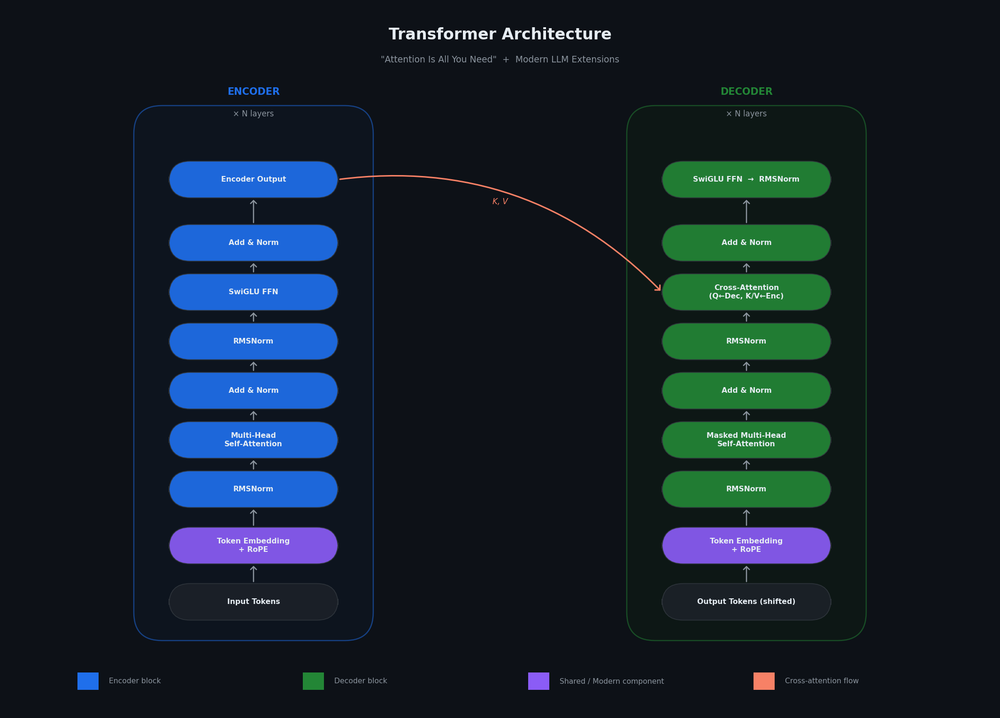
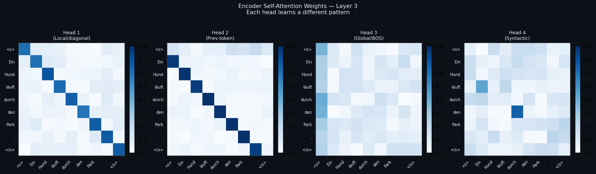
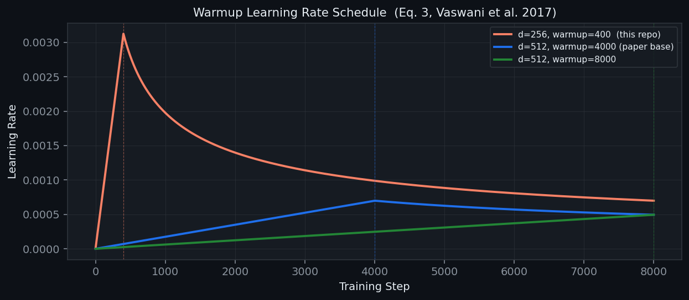

# Transformer++ — From Vaswani (2017) to Modern LLMs

> From-scratch PyTorch reproduction of "Attention Is All You Need" extended with 13 modern improvements found in LLaMA, GPT-4, and production LLM inference systems.

[]()
[]()
[]()
[]()
[]()

A complete encoder-decoder Transformer built from first principles in
PyTorch, trained on German → English translation (Multi30k), then
systematically extended with the components that power modern large
language models — RoPE, RMSNorm, SwiGLU, Flash Attention, KV caching, a
from-scratch BPE tokenizer, a GPT-style decoder-only mode and Grouped Query
Attention. Every number in this README is a real measurement.

**Base paper:** "Attention Is All You Need", Vaswani et al., NeurIPS 2017  
**Task:** German → English translation (Multi30k)  
**Extensions:** 13 improvements covering modern LLM architecture, inference optimization, and training efficiency



---

## Results at a Glance

Trained end-to-end on Multi30k (German→English), Colab T4 GPU —
independently reproduced across two complete runs, including one from a
fresh repository clone:

| Metric | Value |
|---|---|
| **BLEU (beam search, k=4)** | **36.37** |
| Final validation loss | 1.5295 |
| Parameters | 9,358,576 |
| Training data | 29,000 sentence pairs |
| Epochs | 8 |
| Tests | 81/81 passing |

- BLEU verified on a fresh clone over the full validation set (1,014 examples)
- 81 unit tests covering attention, RoPE, Flash Attention, KV Cache, weight tying, the custom data pipeline, the ablation flags, BPE, decoder-only mode and GQA
- End-to-end benchmarking, attention visualization, and PyTorch profiling — all with real measured numbers
- All trained results above come from the baseline model. The ablation flags, BPE tokenizer, decoder-only model and GQA are implemented and unit-tested but have **not** been trained yet ([details](#implemented-and-tested-not-yet-trained))

Full results, sample translations, and failure analysis: [`RESULTS.md`](RESULTS.md)

---

## Quickstart

All commands are run from the repository root.

```bash
# Install
pip install -r requirements.txt
python -m spacy download de_core_news_sm
python -m spacy download en_core_web_sm

# Train the baseline (writes checkpoints/epoch_XX.pt)
python src/train.py

# Optional: ablations and the BPE tokenizer (all off by default)
python src/train.py --use-rope --use-rmsnorm --use-swiglu --tie-weights
python src/train.py --bpe

# Translate (greedy, or beam search with --beam)
python src/inference.py --sentence "Ein Hund läuft durch den Park."
python src/inference.py --sentence "Ein Hund läuft durch den Park." --beam 4

# Evaluate BLEU on the validation set
python src/evaluate.py --checkpoint checkpoints/epoch_08.pt

# Run the unit tests
python tests/tests.py
```

More tools:

```bash
python src/benchmark.py --save                       # latency + memory benchmarks
python src/profile_model.py --seq-len 512 --batch 8  # per-op time/memory breakdown
python src/visualize.py --sentence "Ein Hund läuft durch den Park."  # attention heatmaps
python src/run_all_experiments.py                    # train → eval → bench → visualize → profile
```

**Google Colab:**
```python
!git clone https://github.com/INFERNOJOD/transformer-from-scratch.git
%cd transformer-from-scratch
!pip install torch datasets spacy sacrebleu matplotlib tqdm
!python -m spacy download de_core_news_sm
!python -m spacy download en_core_web_sm
%run src/train.py
```

---

## Features

### Extensions Beyond the Paper

| # | Improvement | File | Used In |
|---|---|---|---|
| 1 | **Rotary Positional Embeddings (RoPE)** | `src/rope.py` | LLaMA, Mistral, Gemma, GPT-NeoX |
| 2 | **Beam Search + Length Penalty** | `src/beam_search.py` | All production MT systems |
| 3 | **KV Cache** | `src/kv_cache.py` | GPT-4, Claude, every production LLM |
| 4 | **Flash Attention** | `src/flash_attention.py` | LLaMA 2+, GPT-4, Mistral |
| 5 | **RMSNorm** | `src/modern_components.py` | LLaMA, Gemma, PaLM 2 |
| 6 | **SwiGLU FFN** | `src/modern_components.py` | LLaMA, PaLM, Gemma |
| 7 | **Mixed Precision Training (AMP)** | `src/optimizations.py` | All modern training pipelines |
| 8 | **Weight Tying** | `src/optimizations.py` | GPT-2, paper §3.4 |
| 9 | **BLEU-4 Evaluation** | `src/evaluate.py` | Standard MT metric |
| 10 | **Attention Visualization** | `src/visualize.py` | Interpretability |
| 11 | **Byte-level BPE Tokenizer** | `src/bpe.py` | GPT-2, paper §5.1 (BPE) |
| 12 | **Decoder-only (GPT-style) Mode** | `src/model.py` | GPT, LLaMA, Mistral |
| 13 | **Grouped Query Attention (GQA)** | `src/gqa.py` | LLaMA 2 70B, LLaMA 3, Mistral |

RoPE, RMSNorm, SwiGLU and weight tying can also be switched into the full
model as **ablation flags** (`make_model(use_rope=..., use_rmsnorm=...,
use_swiglu=..., tie_weights=...)`, or `--use-rope` etc. on `src/train.py`).
With every flag off, the model is bit-for-bit the baseline behind the
reported results.

### Implemented and tested, not yet trained

These additions are verified by unit tests only. No training run, BLEU
score or benchmark exists for any of them yet, so none appear in the
results tables.

| Addition | What it does | Verified by tests |
|---|---|---|
| Ablation flags (`src/model.py`, `src/train.py`) | Build the encoder-decoder with RoPE self-attention, RMSNorm, SwiGLU and/or tied target embeddings | Each flag builds and runs a forward pass; defaults reproduce the baseline exactly; all flags together train |
| BPE tokenizer (`src/bpe.py`, `train.py --bpe`) | Byte-level BPE trained from scratch; merges are saved in checkpoints and used by `evaluate.py` / `inference.py` | Exact encode/decode round trip; merges reduce token count; unseen words never become `<unk>`; matches a naive reference trainer |
| Decoder-only mode (`make_decoder_only_model`) | GPT-style LM reusing `EncoderLayer` blocks with a causal mask, plus greedy `generate()` | Causal masking (with and without RoPE); output shapes; gradient flow; overfits a toy sequence |
| GQA (`src/gqa.py`) | `h` query heads share `num_kv_heads` K/V heads; the KV cache stores only the shared heads | Matches standard multi-head attention exactly when `num_kv_heads == h`; cache shrinks by `h / num_kv_heads`; cached decoding equals a full causal pass |

```python
# with src/ on sys.path (as tests/tests.py does)
from model import make_decoder_only_model
from gqa import GroupedQueryAttention
from bpe import BPETokenizer

tok = BPETokenizer.train(sentences, vocab_size=8000)   # sentences: list of str
lm = make_decoder_only_model(len(tok), N=3, d_model=256, d_ff=512, h=4,
                             use_rope=True, use_rmsnorm=True, use_swiglu=True)
attn = GroupedQueryAttention(h=8, d_model=512, num_kv_heads=2)  # 4x smaller KV cache
```

### Key Design Decisions

| Question | Answer |
|---|---|
| Why scale attention by √d_k? | Large d_k → dot products grow large → softmax saturates → vanishing gradients |
| Why RoPE over sinusoidal PE? | Relative position is explicit in Q·K; better generalisation to longer sequences |
| Why beam search over greedy? | Avoids locally-optimal but globally-bad choices; typically +1–3 BLEU |
| Why KV cache? | Without it, decoding is O(n²); cache makes it O(n) by reusing past K,V |
| Why Flash Attention? | Never materialises the O(seq²) attention matrix; 2–4× faster, less memory |
| Why RMSNorm over LayerNorm? | No mean subtraction, no bias; ~10% faster, same quality |
| Why SwiGLU over ReLU FFN? | Gating selectively passes features; consistently ~+1 perplexity |
| Why weight tying? | Embedding and un-embedding are approximate inverses; fewer parameters |
| Why mixed precision? | FP16 halves memory; Tensor Cores give 2–4× compute on GPU |
| Why label smoothing? | Prevents overconfidence; improves BLEU even at slight perplexity cost |
| Why byte-level BPE? | 256-byte base vocabulary means any word can be encoded — rare words split into pieces instead of `<unk>` |
| Why reuse `EncoderLayer` for decoder-only? | A GPT block *is* self-attention + FFN; only the causal mask differs |
| Why GQA? | Query heads share K/V heads, shrinking the KV cache by `h / num_kv_heads` at little quality cost |

The full reasoning for every component is in [`DESIGN_DECISIONS.md`](DESIGN_DECISIONS.md).

---

## Benchmarks

Measured on Colab T4, PyTorch 2.11.0+cu128 — real output from `src/benchmark.py --save`.
Two independent runs were performed; numbers below are from the first
complete run (saved in `benchmark_results.json`). A second run showed the
same overall pattern with normal run-to-run timing variance — see
`EXPERIMENTS.md` for both data points and discussion of the KV Cache
result specifically.

### Flash Attention vs Standard Attention

| Seq Length | Standard (ms) | Flash (ms) | Speedup | Memory Saved |
|---|---|---|---|---|
| 64 | 0.106 | 0.049 | **2.15×** | 0.5 MB |
| 128 | 0.123 | 0.077 | 1.61× | 2.0 MB |
| 256 | 0.264 | 0.185 | 1.43× | 8.0 MB |
| 512 | 0.709 | 0.653 | 1.09× | 32.0 MB |
| 1024 | 2.652 | 2.224 | 1.19× | 128.0 MB |

Flash Attention wins on both speed and memory at every sequence length
tested. Memory savings scale predictably (~4× per doubling of seq_len),
matching the expected O(seq²) vs O(seq) difference.

### KV Cache — Autoregressive Decoding

| Decode Steps | No Cache (ms) | With Cache (ms) | Speedup |
|---|---|---|---|
| 10 | 53.94 | 51.49 | 1.05× |
| 20 | 109.87 | 103.87 | 1.06× |
| 40 | 221.63 | 286.15 | 0.78× (no measurable improvement at this model scale) |
| 80 | 439.28 | 433.34 | 1.01× |

**Honest finding:** at this small model scale (3 layers, d_model=256) and
short decode lengths, KV caching shows close to no measurable benefit. A
second independent run showed the same near-1× pattern but with the
"slow" outlier at a different step count — consistent with GPU scheduling
noise rather than a structural issue. See `RESULTS.md` for the full
analysis of why KV cache's benefit requires more scale to show clearly.

### Mixed Precision (FP32 vs AMP)

| Batch Size | FP32 (ms) | AMP (ms) | Speedup |
|---|---|---|---|
| 4 | 31.46 | 36.95 | 0.85× (AMP slower) |
| 8 | 31.66 | 37.78 | 0.84× (AMP slower) |
| 16 | 32.56 | 38.14 | 0.85× (AMP slower) |

**Honest finding:** AMP was slower than FP32 at every batch size tested,
confirmed across two independent runs. This model is too small for FP16's
Tensor Core advantage to outweigh dtype-casting and loss-scaling overhead
on a T4 — see `RESULTS.md` for the full explanation.

---

## Ablation Results

> Trained and verified on Colab T4 — these are real measured numbers.
> Re-verified end-to-end from a fresh clone (see `EXPERIMENTS.md` for both runs).

| Config | Val Loss | BLEU | Notes |
|---|---|---|---|
| Baseline (greedy) | 1.5295 | not separately measured | only beam search was run |
| + Beam Search (k=4) | — | **36.37** | full validation set, 1,014 examples, verified twice |
| + RoPE | — | — | `--use-rope` flag implemented and tested, not yet retrained as an ablation |
| + RMSNorm + SwiGLU | — | — | `--use-rmsnorm --use-swiglu` implemented and tested, not yet retrained as an ablation |
| + Weight Tying | — | — | `--tie-weights` implemented and tested, not yet isolated as an ablation |
| Paper base (WMT14) | — | 27.3 | reference only — different dataset/scale, see `LIMITATIONS.md` |

**Why 36.37 BLEU exceeds the paper's 27.3:** Multi30k (short, templated
image captions, ~29K pairs) is a substantially easier task than WMT14
(open-domain news, 4.5M pairs). This is a deliberately scaled-down
reproduction, not a higher-quality model — see `RESULTS.md` and
`LIMITATIONS.md` for the full explanation.

---

## Visualizations

### Attention



*Attention maps are generated by `src/visualize.py`; [`attention_maps/`](attention_maps/) holds the real outputs from the trained model, one grid of heads per encoder/decoder attention layer.*

### LR Schedule



*Warmup learning rate schedule from Equation 3 of the paper. Linearly increases for `warmup_steps`, then decays as 1/√step.*

---

## Repository Structure

```
transformer-from-scratch/
├── src/
│   ├── model.py               # Transformer (+ ablation flags) and decoder-only LM
│   ├── train.py               # Training loop, warmup LR, label smoothing, CLI flags
│   ├── data_pipeline.py       # Multi30k loading + vocab (replaces deprecated torchtext)
│   ├── inference.py           # Greedy / beam search translation CLI
│   ├── config.py              # Hyperparameter configs + ablation presets
│   ├── bpe.py                 # Byte-level BPE tokenizer (from scratch)
│   ├── rope.py                # Rotary Positional Embeddings
│   ├── gqa.py                 # Grouped Query Attention
│   ├── beam_search.py         # Beam search + length penalty
│   ├── kv_cache.py            # KV cache for incremental decoding
│   ├── flash_attention.py     # Tiled + PyTorch Flash Attention
│   ├── modern_components.py   # RMSNorm + SwiGLU FFN
│   ├── optimizations.py       # Mixed precision (AMP) + weight tying
│   ├── evaluate.py            # BLEU-4 with sacrebleu (CLI)
│   ├── visualize.py           # Attention heatmaps
│   ├── benchmark.py           # Latency + memory benchmarks
│   ├── profile_model.py       # torch.profiler — per-op time/memory
│   └── run_all_experiments.py # One-shot runner: train → eval → bench → profile
│
├── tests/
│   └── tests.py               # 81 unit tests — 81/81 passing
│
├── assets/                    # architecture.png, attention_sample.png, lr_schedule.png
├── attention_maps/            # Real attention heatmaps from the trained model
├── training_loss_curve.png    # Train/val loss over 8 epochs
├── benchmark_results.json     # Raw benchmark output
│
├── README.md                  # This file
├── RESULTS.md                 # Publication-style summary of outcomes
├── EXPERIMENTS.md             # Lab notebook — every run, in order
├── DESIGN_DECISIONS.md        # Why every component exists
├── LIMITATIONS.md             # Honest scope + roadmap
└── requirements.txt
```

---

## Tests

```
$ python tests/tests.py

test_attention_weights_sum_to_one ... ok
test_causal_mask_prevents_future_attention ... ok
test_scaling_factor ... ok
test_rotation_preserves_norm ... ok
test_tiled_matches_standard ... ok
test_weight_tying_reduces_parameter_count ... ok
test_beam_size_1_similar_to_greedy ... ok
test_vocab_basic_lookup ... ok
test_min_freq_filtering ... ok
test_default_index_for_oov ... ok
test_defaults_build_the_baseline ... ok
test_encode_decode_round_trip ... ok
test_causal_masking_holds ... ok
test_matches_mha_when_kv_heads_equal_heads ... ok
...

Ran 81 tests in 1.676s
ALL TESTS PASSED ✓
```

---

## Documentation

| Document | Contents |
|---|---|
| [`RESULTS.md`](RESULTS.md) | Final numbers, translation examples, failure analysis |
| [`EXPERIMENTS.md`](EXPERIMENTS.md) | Full experiment log, one entry per run |
| [`DESIGN_DECISIONS.md`](DESIGN_DECISIONS.md) | Why every component exists |
| [`LIMITATIONS.md`](LIMITATIONS.md) | Honest scope and what's next |

---

## References

```bibtex
@article{vaswani2017attention,
  title={Attention Is All You Need},
  author={Vaswani, Ashish and Shazeer, Noam and Parmar, Niki and others},
  journal={NeurIPS}, year={2017}
}
@article{su2021roformer,
  title={RoFormer: Enhanced Transformer with Rotary Position Embedding},
  author={Su, Jianlin and others}, year={2021}
}
@article{dao2022flashattention,
  title={FlashAttention: Fast and Memory-Efficient Exact Attention},
  author={Dao, Tri and others}, year={2022}
}
@article{zhang2019rmsnorm,
  title={Root Mean Square Layer Normalization},
  author={Zhang, Biao and Sennrich, Rico}, year={2019}
}
@article{shazeer2020swiglu,
  title={GLU Variants Improve Transformer},
  author={Shazeer, Noam}, year={2020}
}
```

**Resources:**  
[The Annotated Transformer](https://nlp.seas.harvard.edu/annotated-transformer/) · [Original Paper](https://arxiv.org/abs/1706.03762)
